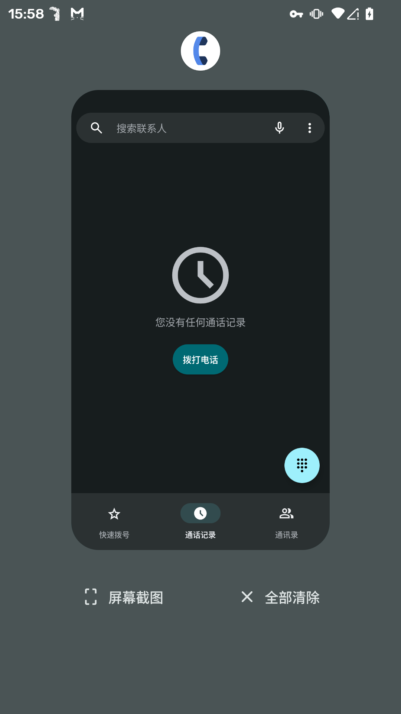
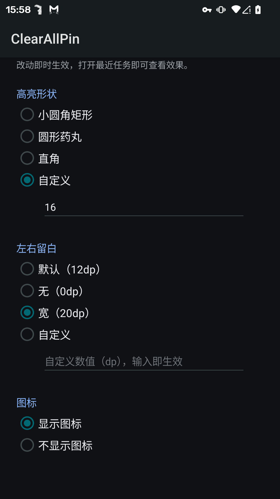

# ClearAllPin

LSPosed 模块，让最近任务常驻一个「全部清除」按钮，适用于 AOSP Launcher3 系桌面，如 LineageOS 的 Trebuchet。

外观与「屏幕截图」按钮完全一致。不改变最近任务现有的排列与交互，原生按钮行为保持原样。

| 最近任务效果 | 样式设置 |
| --- | --- |
|  |  |

## 功能

- 底部操作排常驻「✕ 全部清除」按钮，与「屏幕截图」并排
- 按下时高亮柔和，不遮字
- 高亮形状、左右留白、图标开关可调
- 改动实时生效，无需重启桌面

## 安装

1. 设备已 root，装有 LSPosed 或兼容框架，如 Vector
2. 从 Releases 下载 APK 并安装
3. 框架管理器里启用模块，作用域勾选桌面应用 `com.android.launcher3`
4. 重启桌面或设备

已在 LineageOS 22.2 的一加 5 上实机验证；Pixel Launcher、MIUI、三星等非 Launcher3 系桌面不支持。

## 设置

打开应用列表里的 ClearAllPin 调整样式，改完立即生效：

- 高亮形状：小圆角矩形 / 圆形药丸 / 直角，或输入自定义圆角数值
- 左右留白：三档预设，或输入自定义数值
- 图标：两个按钮统一显示或隐藏

## 构建

运行 `bash build.sh`。需要 JDK 8、JDK 21、Android build-tools 和 platform，脚本里的工具链路径按本机环境调整。

## 许可证

MIT
